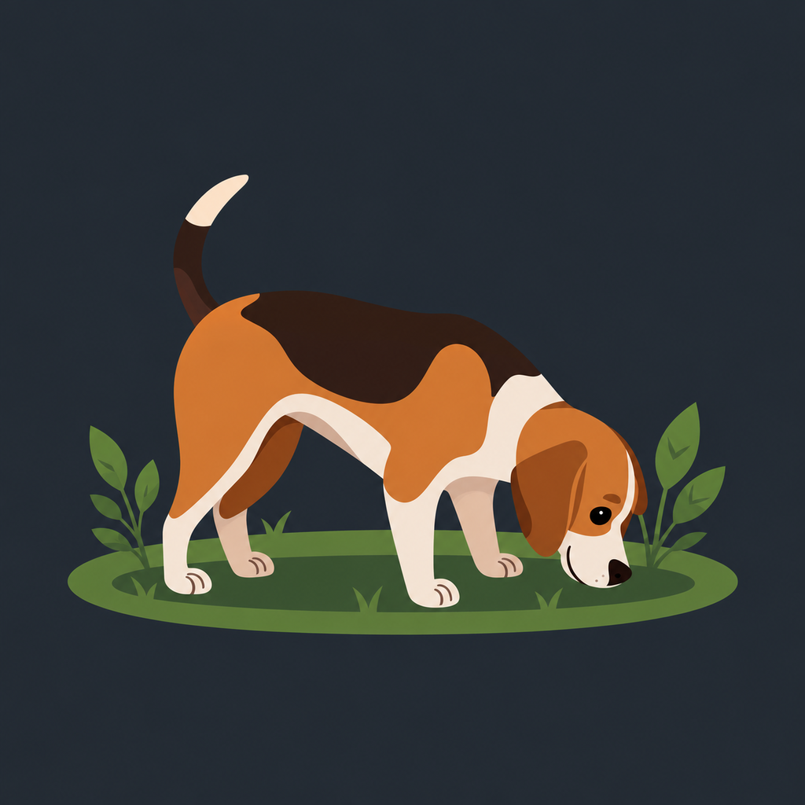

<p align="center">
  
</p>

<h1 align="center">baegle</h1>
<p align="center">A desktop companion for exploring your databases.</p>

Browse tables, run queries, and work with your data in one place. Built with Go, Wails 3, and Vue.

- Connect to PostgreSQL, MySQL, SQLite, and MongoDB.
- Browse schemas, tables, and documents.
- Run SQL queries or MongoDB JSON commands.
- Edit table data, import and export data, and save query consoles.
- Connect to remote databases through SSH tunnels.

## Download

Grab a Linux x86_64 build from [Releases](https://github.com/high-horse/dblens-database-viewer/releases).

**AppImage:** make it executable, then launch it:

```bash
chmod +x baegle*.AppImage
./baegle*.AppImage
```

**Debian / Ubuntu:** install the `.deb` package:

```bash
sudo apt install ./baegle.deb
```

## Development

Requires Go 1.25+, Node.js 22+, the project's Wails 3 CLI version, and native Wails build dependencies. Linux builds use GTK4 and WebKitGTK 6.0 by default.

```bash
cd frontend && npm ci && cd ..
go install github.com/wailsapp/wails/v3/cmd/wails3@v3.0.0-alpha2.117
wails3 task dev PACKAGE_MANAGER=npm
```

Build an executable or Linux packages:

```bash
wails3 build PACKAGE_MANAGER=npm                 # bin/baegle
PACKAGE_MANAGER=npm make linux                  # AppImage + .deb in bin/
```

See [release-document.md](release-document.md) for publishing instructions.
